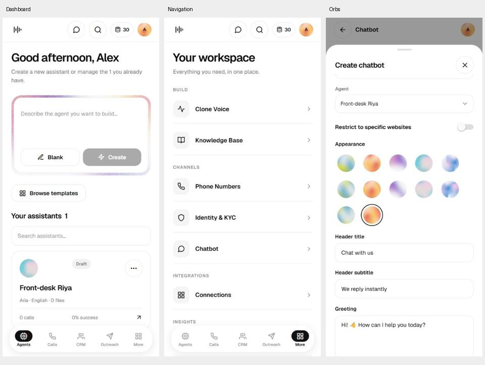

# Website and mobile review — 16 November 2026

Compared the signed-in HeyRik website with the local Expo frontend. Inspected website sidebar modules, six agent sections, account utilities, chat, and accessible creation/configuration dialogs. The website account has one draft agent and empty calling, campaign, knowledge, and support histories. No live purchase, call, key creation, upload, connection, or support submission was made.

## Fixed in this review

- Removed destinations from More that already have a primary tab. Kept the compact icon header and focused back navigation on detail screens.
- Added agent appearance selection, editable instruction titles, accessible move-up/down controls, primary language selection, variable/source search, and missing recent-call metrics. Long titles are limited to two lines; voice descriptions now wrap inside their cards at 320 px.
- Bundled the complete original 12-orb artwork set and used it for agent/chatbot selection. Added chatbot editing and selected-orb previews.
- Added the website's newer Analytics chart configuration workflow: templates/search/categories, metric/breakdown/interval, appearance, placement, edit/reorder/remove, reporting periods/comparison, and shared filters. Configurations persist locally; empty charts do not invent call results. Export remains disabled without production data.
- Added campaign agent filtering, CRM folder selection, and sample CSV download. Number wizard progress now responds to navigation taps.
- Fixed billing details: reopen with saved fields, update rather than append duplicate details, and display the latest business/address/invoice fields.
- Added profile photo selection and removal. Browser photos survive reload; native photos use app-owned files instead of adding large base64 images to the shared storage record.
- Added local Rik chat history, renaming and new chats. Added documentation links, ticket search, optional screenshot filename selection, and corrected the initial support priority.
- Made sheet/selection headings shrink, kept sheet footers clear of native safe areas, and wrapped choice labels.
- Fixed the static preview server's CSS MIME type, missing-asset responses, and stream error handling so a rebuild cannot crash the server when a requested file disappears.

## Browser coverage

| Area | Checked |
| --- | --- |
| Authentication | Login validation, signup/recovery arrangement, password control; both onboarding steps, expanded languages, primary-language choice, back and skip |
| Main navigation | Agents, Calls, CRM, Outreach, More at requested widths 320, 393 and 430; nested back navigation and focused editor |
| Secondary pages | Clone Voice, Knowledge Base, Phone Numbers, Identity & KYC, Chatbot, Connections, Analytics, Billing, Settings, API keys, Planning tools, Help & support; top and lower content |
| Agent studio | Details, Variables, Call Settings, Integrations, Knowledge, Recent Calls; all six settings disclosures; title edit/reorder, language/appearance selection, scripted chat test, long-name layout |
| Billing/settings | All six billing sections and four settings sections; two consecutive billing edits; photo selection using a bundled sample image |
| Local workflows | Chart creation/appearance/filter changes, chatbot create/edit/widget preview, CRM creation and Table/Kanban/Folders views, campaign save/filter/folder selection, key create/revoke, screenshot selection and ticket save |
| Chat/state | Rik send/rename/new/history/reopen, route links; stored photo, renamed instructions, languages, and other local records after reload |

All 36 secondary-page width measurements had matching document/viewport widths and no detected broken images. The requested 393 px viewport was reported as 394 CSS px by this browser. Five primary tabs and six editor sections also had no document overflow. Measurements are in [mobile-audit-2026-11-16.json](mobile-audit-2026-11-16.json); visual checks additionally caught and fixed the voice-card clipping that document-width checks alone missed.

Lint, TypeScript, four CSV tests, web export, and iOS/Android JavaScript bundle exports passed. Static preview HTTP checks confirmed HTML 200, CSS 200 with `text/css`, and missing bundle 404 without stopping the server. Expo LAN is on port 8083; the production web snapshot is on 8082.

## Verification limits

This remains the requested frontend demo. Authentication, AI generation/chat, calling, voice cloning, indexing, crawling, OAuth, KYC, payments, and sending support reports are disconnected. Voice samples are a local subset; screenshot attachments retain filenames, not uploaded image content. Public documentation opens on the website. Provider setup excludes real credentials.

Empty live-account data prevents comparison of real recordings/transcripts, populated analytics, campaign execution results, paid invoices, and support reply histories. Nested vendor authentication/configuration is represented by local connection previews. This review is not a claim that every possible website state or input combination has been reproduced. Native device testing of keyboards, safe areas, SwiftUI tabs/controls, pickers, haptics and performance is still required; browser and bundle checks are not physical-device evidence. No APK was built.
